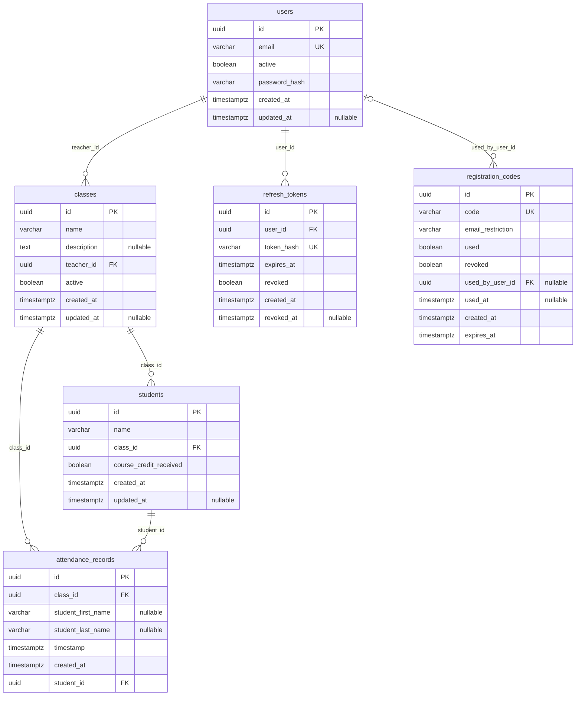

<!-- GENERATED, by `just erd` (api/scripts/erd.py). Do not edit this file by hand:
     it is introspected from the migrations, and tests/test_schema_doc.py fails when it and
     they disagree. Change alembic/versions/, then regenerate. -->

# Database schema — Student Attendance Tracker

> **Scope:** current implementation. Introspected from an empty database with `alembic upgrade
> head` run against it, which is the command the deploy job runs, so this is what
> `alembic/versions` produces rather than what `app/models` believes it produces. Those two can
> drift, and when they do, production has the migrations.
> **Code:** `alembic/versions`, `scripts/erd.py`, `tests/test_schema_doc.py`
> **Arrows:** one foreign key each, drawn parent to child. `||` means the child always has a
> parent — its key is NOT NULL — and `|o` that it may have none; `o{` means zero or more
> children. The label names the child's columns.
> **Attributes:** at most one key marker (PK, else FK, else UK), and `nullable` where the column
> accepts null. Types carry no length or precision: the migration is the authority on those, and
> a second copy here is a second place to update.
> **Not drawn:** defaults, check constraints, and `alembic_version` — the migration runner's
> bookkeeping, not a table of this domain. Indexes and delete behaviour are below the diagram,
> because a line cannot carry either.
> **Authorization is not in this picture.** There is no row-level security. A foreign key to
> `users` records which teacher owns a row and refuses nothing: INV-1 is enforced in
> `app/services/class_service.py`, the one site `tests/test_authorization.py` proves from the
> denied side, and a query written without it reads every teacher's rows (`INVARIANTS.md`).
> **Every `timestamptz` holds an instant, and every date filter means a local day** in
> APP_TIMEZONE (default Europe/Helsinki). `attendance_records.timestamp` is compared against
> local-midnight boundaries rather than UTC ones, so the column's type says less than the
> queries do — spec 0009, spec 0011 and
> `docs/adr/0011-list-attendance-dates-are-local-days.md`.

## What a delete destroys

`CASCADE` here is a decision rather than a default: deleting a Class destroys its students and
every attendance record in it, and deleting a Student destroys that student's whole history. The
school holds the course credit and this app is a tally sheet, so the Owner declined to make that
an invariant — `INVARIANTS.md`, *Deliberately not invariants*. `SET NULL` keeps the row and
forgets who it pointed at; `NO ACTION` is PostgreSQL's default, and refuses the delete instead.

| child | column | parent | on delete |
| --- | --- | --- | --- |
| `attendance_records` | `class_id` | `classes` | `CASCADE` |
| `attendance_records` | `student_id` | `students` | `CASCADE` |
| `classes` | `teacher_id` | `users` | `CASCADE` |
| `refresh_tokens` | `user_id` | `users` | `CASCADE` |
| `registration_codes` | `used_by_user_id` | `users` | `SET NULL` |
| `students` | `class_id` | `classes` | `CASCADE` |

## Indexes

A unique index is a rule, not a speed-up. `ix_students_name_class_unique` is the one to know: it
is over `lower(name)` rather than `name`, which is what makes a class's student names
case-insensitively unique, and it is the reason two spellings of one student cannot both exist
(`GLOSSARY.md`, *Student*).

| table | index | over | unique |
| --- | --- | --- | --- |
| `attendance_records` | `ix_attendance_records_class_id` | `class_id` | no |
| `attendance_records` | `ix_attendance_records_student_id` | `student_id` | no |
| `attendance_records` | `ix_attendance_student_name` | `student_last_name`, `student_first_name` | no |
| `attendance_records` | `ix_attendance_timestamp` | `timestamp` | no |
| `classes` | `ix_classes_teacher_id` | `teacher_id` | no |
| `refresh_tokens` | `ix_refresh_tokens_expires_at` | `expires_at` | no |
| `refresh_tokens` | `ix_refresh_tokens_token_hash` | `token_hash` | yes |
| `refresh_tokens` | `ix_refresh_tokens_user_id` | `user_id` | no |
| `registration_codes` | `ix_registration_codes_code` | `code` | yes |
| `registration_codes` | `ix_registration_codes_email_restriction` | `email_restriction` | no |
| `students` | `ix_students_class_id` | `class_id` | no |
| `students` | `ix_students_name_class_unique` | `lower(name::text)`, `class_id` | yes |
| `users` | `ix_users_email` | `email` | yes |
