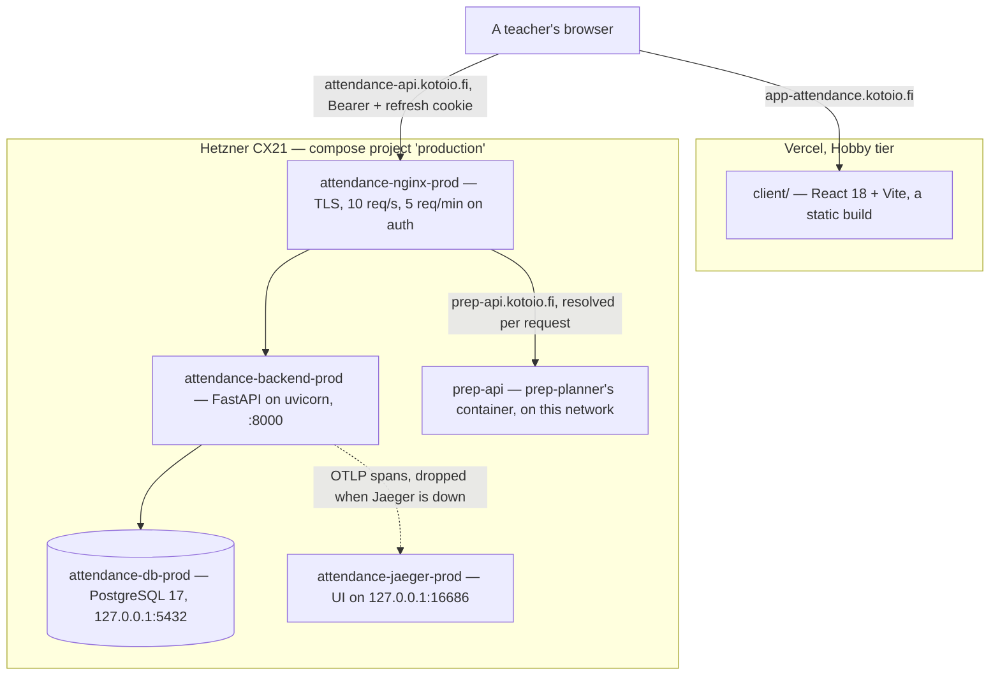
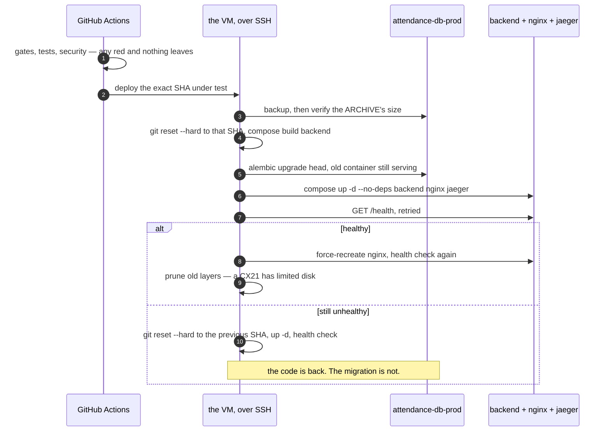

# Architecture — Student Attendance Tracker

What runs where, and the one flow whose failure modes cost something. The tables are
`api/docs/schema.gen.md`, generated from the migrations rather than drawn.

**This file holds no rule another file owns.** The screens and their states are
`client/DESIGN.md`; the domain's rules and their enforcers are `api/INVARIANTS.md`; the words are
`GLOSSARY-MAP.md`, `api/GLOSSARY.md` and `client/GLOSSARY.md`; why each load-bearing call was
made is `api/docs/adr/` and `client/docs/adr/`; the gates and the hard limits are `AGENTS.md`.
When this file and one of those disagree, the other one is right and this file is stale — say so
in the diff.

## The system

> **Scope:** current, 2026-10-30. Production. `deployment/local/docker-compose.yml` is the
> local stack: the database, the backend and Jaeger, with no proxy in front, so a local client
> talks to the API directly. `cd api && just run` runs the API alone.
> **Code:** `client/`, `api/`, `deployment/production/docker-compose.yml`,
> `deployment/production/nginx.conf`
> **Arrows:** a solid line is a request, pointing the way it is made. A dashed line is fire and
> forget: nothing waits for it and nothing fails when it is dropped.
> **Constraints a picture cannot carry:**
> - **The arrow into Postgres carries no authorization.** There is no row-level security: INV-1
>   ("only a teacher associated with a Class may read or change it") is enforced in
>   `api/app/services/class_service.py`, one site, proven from the denied side by
>   `api/tests/test_authorization.py`. A query written without that filter reads every teacher's
>   rows and the database allows it.
> - **Two products share this proxy.** `prep-api.kotoio.fi` is prep-planner's, a separate compose
>   project whose container joins `attendance-prod-network`. Its upstream is reached through a
>   variable so Docker's DNS is consulted per request: a literal `proxy_pass` would pin the
>   address prep had at startup, and nginx refuses to start at all when a literal upstream does
>   not resolve, so prep being down would take this API down with it.
> - **Jaeger's UI has no login**, which is why it is published to `127.0.0.1:16686` and reached
>   over an SSH tunnel. Do not republish it as `16686:16686`: Docker writes its own iptables
>   rules and a published port bypasses UFW, and span `http.url` carries the query string, so
>   autocomplete traces hold partial student names.
> - **The access token never reaches disk.** It lives in a variable in
>   `client/src/api/client.ts` and dies with the tab; the 30-day refresh token is an HTTP-only,
>   host-only cookie, so the browser sends it to this API and to nothing else under `kotoio.fi`.

The database is published to `127.0.0.1` only and the backend is not published at all, so
everything a browser can reach goes through nginx. The firewall is the VM's own and outside this
repository: `deployment/README.md` is the setup it was built from, and that opens 22, 80 and 443.

## A backend deploy

Every push to `main` that passes its gates deploys, which is the Owner's deliberate choice and
the reason this flow is drawn: its first execution is its own verification, and the one step it
cannot undo is in the middle.

> **Scope:** current, 2026-10-30.
> **Code:** `.github/workflows/backend.yml`, `deployment/scripts/backup-db.sh`,
> `deployment/production/docker-compose.yml`
> **Arrows:** a sequence. Time runs down, and each arrow is a command the job runs over SSH on
> the VM, not a network call between components.
> **Constraints a picture cannot carry:**
> - **The code rolls back; the schema does not.** By the time a health check fails, alembic has
>   already run. The pre-deploy backup is the only schema rollback path, and restoring it
>   discards every write since, so it is deliberate and manual.
> - **The backup is verified by its artifact, not its exit code.** `backup-db.sh` pipes `pg_dump`
>   into `gzip` without `pipefail`, so a failed dump writes a truncated archive and exits 0. The
>   job checks the file's size and refuses to deploy without a usable one.
> - **Two deploys never overlap and neither is cancelled mid-flight** (`concurrency: group:
>   be-deploy-production`, `cancel-in-progress: false`).
> - **`vars.DEPLOY_ENABLED` must be `'true'`** or the job is skipped. It was the monorepo
>   cutover's switch and is now the kill switch.
> - **Migrations run twice, idempotently.** The explicit step runs them while the old container
>   is still serving, and the new container's own command runs `alembic upgrade head` again at
>   boot.
> - **Only the services named on the `up` line are recreated.** A service added to the compose
>   file and left off `up -d --no-deps backend nginx jaeger` never starts on the VM.

The frontend path is shorter and has no step it cannot undo: gates, the browser walk and the
secret scan, then `vercel deploy --prebuilt --prod`. It deploys only on a push to `main`, where
the backend also accepts a `workflow_dispatch`. Vercel's own git integration has to stay
disconnected, or both paths deploy and race — and an empty **Deploy Hooks** list is not evidence
that it is off.
